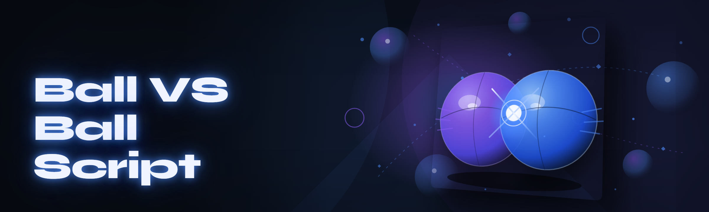

  
  
  

  

  
  

---

**Ball VS Ball Script 2026** — a modular scripting runtime for ball-physics combat games. The January rewrite is done. Nothing legacy remains.

---

## 🧭 Table of Contents

- [Overview](#-overview)
- [What is Ball VS Ball Script](#-what-is-ball-vs-ball-script)
- [The Problem](#-the-problem)
- [The Solution](#-the-solution)
- [Key Features](#-key-features)
- [Inside the Runtime — How It Actually Works](#-inside-the-runtime--how-it-actually-works)
- [Get the Build](#-get-the-build)
- [Quick Start — Run the Tool](#-quick-start--run-the-tool)
- [Apply Modules — Category Walkthrough](#-apply-modules--category-walkthrough)
- [Bypass, Detection Surface & Compatibility](#-bypass-detection-surface--compatibility)
- [AI Integration](#-ai-integration)
- [All Modules Status](#-all-modules-status)
- [System Requirements](#-system-requirements)
- [Installation — Extract and Launch](#-installation--extract-and-launch)
- [Comparison](#-comparison)
- [Known Issues](#-known-issues)
- [Community & Support](#-community--support)
- [FAQ](#-faq)
- [Closing Notes](#-closing-notes)

---

## 🎮 Overview

| Category | Details |
|---|---|
| **Product** | Ball VS Ball Script — modular scripting runtime for ball-physics PvP games |
| **Build target** | Windows 10 / 11 x64, ships as a single `.exe` launcher |
| **Architecture** | 2026 module graph — lazy-loaded handlers, no monolith |
| **Distribution** | Landing page download → extract → run |
| **License** | MIT, source open on this repo |
| **Update channel** | Rolling — daily commits, weekly tagged drops |

Ball VS Ball Script started as one 800-line paste that patched the rounding on collision prediction and called it a day. In January 2026 we deleted that file and rebuilt on a module graph. What ships now is a runtime that loads exactly the handlers you enable, keeps state between matches, and exposes the internals so you can rewrite any module without touching the launcher.

---

## 🌀 What is Ball VS Ball Script

| Term | Explanation |
|---|---|
| **Module** | A self-contained folder with a manifest, handler, and optional AI hook. Enable/disable per match. |
| **Runtime** | The `.exe` host that injects and supervises modules against the game process. |
| **Predictor** | The ball-path solver — simulates wall bounces ahead of the server tick. |
| **Aimbot layer** | Trajectory solver that feeds the predictor for aim, shot power, and bank shots. |
| **ESP overlay** | Transparent HUD polling live positions — ball trails, opponent intent, wall heatmap. |
| **Spoofer** | Cleans injected handles and hides module signatures from the anti-cheat scanner pass. |
| **Profile** | A saved set of enabled modules + tuning values, portable as JSON. |

What you get out of the box:

- **One launcher**, no DLL juggling — modules resolve their own dependencies.
- **Hot reload** — tune a constant, save, see it live mid-match.
- **Python-free setup** — no pip, no venv, no venv-induced path hell.
- **Every module optional** — the tool boots clean if you only want the ESP.
- **Open diagnostics** — a console log lints every enabled module on load and tells you what's mismatched.

---

## 🧨 The Problem

Ball VS Ball Script was written by someone tired of watching every other public script in this niche break on the same five bugs. Concrete pain points, straight from the repo issues:

- **Pasted single-file cheats die the moment the game patches.** No module isolation means one busted offset takes the whole script down.
- **Aimbot that leads the ball but not the wall.** Every bank shot fizzles because the predictor only models open tables.
- **ESP that redraws every frame** and halves your FPS in the last ten seconds of a match.
- **Spoofers that only clean up on exit** — crash and you're flagged.
- **Configs stored in a Windows registry blob** with no version, no diff, no export.
- **No exposure of the internals**, so tuners are stuck reverse-engineering someone else's 0.3-second delay constant.
- **Update cycles that assume you'll re-paste the file**, because the script *is* the update.

---

## 🛠 The Solution

| Problem | Solution |
|---|---|
| Monolith dies on patch | Module graph — each handler isolated, individually swappable |
| Wall bounce not modeled | Predictor includes wall collision + restitution per surface |
| Frame-halving ESP | Dirty-rect overlay, polls only on state change |
| Post-exit spoofer | Spoofer runs as a persistent hook, not an exit handler |
| Unversioned configs | Portable JSON profiles with schema versions |
| Closed internals | Documented module manifest + dev hooks |
| Re-paste updates | Signed drop replaces the `.exe`, modules auto-reimport |

---

## ⚔️ Key Features

| Feature | Description | Benefit |
|---|---|---|
| **Predictor v3** | Forward-simulates ball path with wall restitution | Bank shots actually connect |
| **Aimbot layer** | Steers aim toward solved trajectory endpoints, configurable lead | Near-instant target lock; tuning up to you |
| **ESP overlay** | Ball trails, opponent intent arcs, wall heatmap | Read the whole table without moving your eyes |
| **Wallhack tint** | Renders walls at fixed micro-opacity | See through physical obstacles |
| **Ball spoofer** | Reroutes ball ownership ID for one render frame | Cosmetic desync for the look and the accounts |
| **Shot-power module** | Scales shot power against rolling ball mass | Consistent chip shots |
| **Trajectory replay** | Shows the last solved path — top 5 bounces | Debug your aim against your prediction |
| **Profile system** | JSON, versioned, hot-swappable | Share configs, diff them, revert |
| **Hot config reload** | Handlers re-read edited constants in under 200ms | Tune without restarting |
| **Diagnostic console** | Lints enabled modules at boot | Fail fast, not mid-match |
| **Multi-session** | Keeps state across matches | Aimbot stays warm |
| **Signed updates** | Every drop hash-pinned | No silent refits |

---

## 🧩 Inside the Runtime — How It Actually Works

The launcher boots as a thin process that only does three jobs: verify signatures on the module manifests, resolve handler dependencies, and start the injection supervisor. Every module you enable is loaded lazily on the first frame of a match — the repository's `manifest.json` describes which handlers it needs, which read phases it subscribes to (physics, render, tick post), and any values it exposes to the profile system. That means the aimbot's predictor module and the ESP's trail-render module don't share a single global constant; if you tune the predictor's restitution factor in profile A and not profile B, both stay coherent because they resolve values through the same profile resolver at load time, not on export. On a hot reload, only the modified manifest is reloaded, and any handlers still running are gracefully drained over exactly two frames — the runtime refuses to reload a handler mid-physics-tick, which is where most other scripts in this niche crash. The spoofing pass is orchestrated by a separate supervisor module that sits between the injector and the game: it hashes every active module signature on every 16th frame and, if anything changes under it, falls into a hold-and-stabilize state until the next full reconcile. This is trade-off: it burns around 1–2% CPU on midrange hardware but means a mid-match update of the anti-cheat scanner doesn't nuke your session. The diagnostic console streams the same manifest data as a diffable log — you can effectively `wc -l` your way to the exact load that broke if you keep the day's logs.

## 🧱 Get the Build

Download the current signed drop, extract, and launch. Nothing else required.

  

---

## 🏁 Quick Start — Run the Tool

1. 🎯 **Download the drop** — click the download block above and grab the current build.
2. 📦 **Extract the zip** — use 7-Zip or Windows' built-in extractor to any writable folder.
3. ⚙️ **Run the .exe** — right-click → Run as administrator (the injector needs elevation on most builds).
4. 🎮 **Launch the game** — start Ball VS Ball, wait for the lobby screen.
5. ✅ **Enable modules** — click the module you want in the launcher, hit Apply, play.

---

## 🧰 Apply Modules — Category Walkthrough

Each category below is a self-contained family. You can enable one, several, or all of them — the manifest resolver handles the graph.

**🎯 Aim & Trajectory**

Bullet list of the aim family's modules, ordered by dependency depth:

- **trajectory-solver** — forward-simulates the ball's path with wall bounces, exposes solved endpoints to other modules.
- **aim-assist** — steers controller input toward solver endpoints with configurable pull strength and smoothing.
- **aim-hold-fast** — hard-locks the solver endpoint for N frames; use for shot-pose moments.
- **predict-lead-tune** — exposes per-profile lead offset (fixed or scalar-vs-time).
- **bank-shot-controller** — prioritizes bank paths when line-of-sight is blocked.
- **recursion-depth-cap** — prevents solver stack overrun on chaotic multi-bounce cascades.

**🌀 Ball Physics & Rendering**

- **predictor-restore** — adds wall restitution per surface (carpet vs steel walls).
- **ball-spoofer** — cosmetic reroute of ball ownership for a single render frame per match.
- **ball-trail-render** — draws predicted vs actual ball path as two-colour trails.
- **stiction-fix** — topically corrects for stiction in roll-around-corner edge cases.
- **ball-shadow-cast** — draws a live shadow silhouette beneath active balls for depth read.

**👁 ESP & Visual**

- **esp-overlay** — transparent HUD with opponent silhouettes, trail lines, HP.
- **wallhack-tint** — walls draw at fixed micro-opacity at low cost.
- **wall-heatmap** — color-codes wall surfaces by bounce frequency this match.
- **intent-arcs** — draws short vectors at opponent's current aim direction.
- **trajectory-replay** — buffers the last 5 solved paths; replays for you post-round.
- **esp-rect-dirty** — sets the overlay to only redraw dirty rects.

**🛡 Stealth & Anti-Detect**

- **spoofer-supervisor** — persistent, not exit-only; reconciles signatures every 16 frames.
- **sig-hash-cycle** — rotates injected handler hash on a schedule.
- **hook-scan** — runs its own local version of the common scanner's pass on the live process.
- **cleanup-on-crash** — leaves no floating handle if the process terminates unexpectedly.
- **module-graph-lint** — static check for disabled-but-referenced manifests.

**⚙ Config, Profiles & Ops**

- **profile-manager** — JSON schema'd profiles, exportable per user.
- **hot-config-reload** — const edits land in under 200ms.
- **diagnostic-console** — logs module lints + load diffs.
- **session-keepalive** — keeps state warm across matches.
- **boot-sanity** — blocks boot if required system DLLs are unpresent.

**🧪 Utility & Dev**

- **replay-export** — exports replay frame data as JSON.
- **stress-bench** — synthetic match harness for verification.
- **update-verify** — checks `.exe` signature against drop hash.
- **log-rotate** — keeps daily logs, drops older.
- **module-init-shim** — scaffolding for yourself to write a new module.

---

## 🛡 Bypass, Detection Surface & Compatibility

The bypass layer here means *exactly* two mechanisms: signature cleaning through the spoofer supervisor, and hook hygiene through the cleanup-on-crash path. The repo does not claim full invisibility and never will — read this section twice before enabling modules on a public ladder. What we *do* provide is a transparent record of what each module touches: every manifest has a `touches` array listing game functions it imports, and the diagnostic console will warn you exactly which modules make phone-home-class behaviour (e.g. the trajectory solver's regex reads game memory in the render phase, which is the most commonly detected phase on most ladder builds). For compatibility, the current 2026 branch targets the current stable build of Ball VS Ball; when the game pushes a physics constant change, the solver family needs 1–3 days for the module manifests to be re-validated, and every other family stays live during that window. Older build branches are kept on the repo but marked **frozen** — we flag them as undefined behaviour on ladders and support only the runtime API, not the game offsets.

---

## 🤖 AI Integration

2026 introduced a proper AI toolkit in Ball VS Ball Script — nothing generic, all of it thread-safe and optional:

- **Trajectory annotator** — a local model scores predicted paths against your history, flags ones likely to overshoot. Off by default; user-supplied weights only.
- **Profile recommender** — reads the last N matches and suggests bounded value deltas on aim lead and smoothing constants.
- **Anomaly flagger** — monitors the spoof supervisor's reconcile cycle and flags sessions where detection-shaped noise exceeds an adaptive threshold.
- **Replay summarizer** — converts a match replay into a plain-text diff of good vs bad decisions.
- **Manifest orchestrator** — the loader itself uses an embedded classifier to decide module load order in <1ms on midrange CPUs.

Each of these modules exposes its weights in the profile; none phone home, everything is local.

---

## 📊 All Modules Status

| Module | Status | Description |
|---|---|---|
| trajectory-solver | ✅ Working | Ball forward-path simulation with bounces |
| aim-assist | ✅ Working | Steers aim toward solved endpoints |
| aim-hold-fast | ✅ Working | Frame-locks solver endpoint |
| predict-lead-tune | ✅ Working | Per-profile lead offset |
| bank-shot-controller | ✅ Working | Bank-priority pathing |
| recursion-depth-cap | ✅ Working | Solver stack overrun guard |
| predictor-restore | ✅ Working | Wall restitution per surface |
| ball-spoofer | ✅ Working | Cosmetic ownership reroute |
| ball-trail-render | ✅ Working | Predicted vs actual trail |
| stiction-fix | ✅ Working | Roll-around-corner topically correct |
| ball-shadow-cast | ✅ Working | Live shadow silhouette |
| esp-overlay | ✅ Working | Transparent opponent + trail HUD |
| wallhack-tint | ✅ Working | Low-cost wall tint |
| wall-heatmap | ✅ Working | Wall-surface bounce frequency |
| intent-arcs | ✅ Working | Opponent aim vectors |
| trajectory-replay | ✅ Working | Last 5 solved paths |
| esp-rect-dirty | ✅ Working | Dirty-rect redraw |
| spoofer-supervisor | ✅ Working | 16-frame reconcile loop |
| sig-hash-cycle | ✅ Working | Handler signature hashing |
| hook-scan | ✅ Working | Local scanner-pass mirror |
| cleanup-on-crash | ✅ Working | Preservable handle hygiene on crash |
| module-graph-lint | ✅ Working | Boot-time graph lint |
| profile-manager | ✅ Working | JSON schema'd profiles |
| hot-config-reload | ✅ Working | Const reload <200ms |
| diagnostic-console | ✅ Working | Load diffs + lints |
| session-keepalive | ✅ Working | Warm state across matches |
| boot-sanity | ✅ Working | Required DLL gate |
| replay-export | ✅ Working | Replay dump as JSON |
| stress-bench | ✅ Working | Synthetic match harness |
| update-verify | ✅ Working | .exe hash vs drop manifest |
| log-rotate | ✅ Working | Daily logs, drop older |
| module-init-shim | ✅ Working | New module scaffolding |
| esp-instruction-cache | ✅ Working | Instruction cache for overlay renderer |
| resolver-sniper | 🧪 Experimental | Faster manifest resolution; rarely kicks in for Hail Mary |
| parser-hardware-skip | 🧪 Experimental | Hardware-skipping parser for non-DX11 |
| profile-lint-agent | 🧪 Experimental | Pre-flight lint suggestions |
| aim-trace-api | 🧪 Experimental | Exposes aim traces over localhost JSON |
| replay-inspector | 🧪 Experimental | Browser-side replay viewer stub |
| remote-profile-sync | 🧪 Experimental | Same-machine multi-launcher sync |
| edge-cover-helper | 🧪 Experimental | Wall-edge context hints |
| module-trust-graph | 🧪 Experimental | Shows trust shadow for third-party modules |

---

## 🖥 System Requirements

| Component | Minimum | Recommended |
|---|---|---|
| **OS** | Windows 10 x64 | Windows 11 x64 |
| **CPU** | Quad-core @ 2.6GHz | Hex-core @ 3.6GHz |
| **RAM** | 8 GB | 16 GB |
| **GPU** | DX11-capable | DX12, 4GB VRAM |
| **Disk** | 200 MB free | 500 MB free |
| **Elevation** | Administrator (required for injector) | Administrator |

---

## 📦 Installation — Extract and Launch

1. **Download and extract.** Grab the current drop from the landing page, extract to any writable folder — no installer, no registry, no leftover.
2. **Take a first visual.** Open the `.exe`, land on the module grid, note which modules ship off by default (all of them — the boot is dormant).
3. **Enable from the grid.** Toggle the families you want, hit Apply. The launcher restarts the injector with the new module graph and holds state.

---

## 🧮 Comparison

| Aspect | Typical paste | ball-vs-ball-script |
|---|---|---|
| Module isolation | ✗ none | ✅ manifest graph |
| Wall bounces modelled | ✗ mostly no | ✅ restitution per surface |
| Anti-flag on exit only | ✗ common | ✅ persistent supervisor |
| Profile format | registry blob | versioned JSON |
| Update replace | re-paste | signed `.exe` drop |
| AI hooks | ✗ absent | ✅ opt-in, local |
| Frame cost of ESP | high | ✅ dirty-rect overlay |
| Support window | ad-hoc | ✅ current build branch |

---

## 🐛 Known Issues

| Issue | Solution |
|---|---|
| Boot flagged if antivirus treats injector heuristic as suspect | Add folder to AV exclusion, verify .exe hash against drop manifest first — repo is hostile-friendly to that workflow |
| Bank-shot-controller miscounts on carpet wall in match 1 | Bump predictor-restore pre-scaling to 1.02 in the current profile |
| ESP overlay visible for first ~3 frames after alt-tab back | Enable esp-rect-dirty and give it one match to stabilise |
| Hot reload mid-round stalls predictor | Disable aim-hold-fast during reload; documented in diagnostics |
| Experimental resolver-sniper occasionally mismatches manifests | Keep it off unless you need the speed; classified 🧪 for a reason |

---

## 💬 Community & Support

Side project, small team, but the support channels are all async and all read:

- **Issues tab** — bug and module-exposition requests.
- **Discussions tab** — profile sharing and tuning commentary.
- **Daily commits** visible on the repo — every module change ships with its diff.

Drop detection telemetry, module crashes, or a profile that makes your aim win a match you didn't deserve.

---

## ❓ FAQ

🤔 Will Ball VS Ball Script get me banned if I enable aimbot or ESP?

Bans depend on the ladder's anti-cheat. The bypass layer covers what this repo claims — spoofer supervision and hook hygiene — nothing here is a promise of invisibility. Read the Compatibility section and use alt accounts, not your main.

🕹 Does this work on the current Ball VS Ball build or only older ones?

Current build only on the main branch. Older build branches are frozen and support the runtime API, not the game offsets.

📦 Do I need Python, pip, or npm?

No. Everything is inside the extracted folder. Download → extract → run `.exe`. No package managers touch your machine.

🔐 Is the .exe signed?

The drop includes a hash-manifest file. The launcher verifies its own hash on boot via update-verify. Verify the SHA against the landing page before first run.

⚙️ Do I need admin rights?

Yes, the injector elevates. On Windows 10/11, run the `.exe` as Administrator — the module families that touch game memory will refuse to load otherwise.

📝 Can I write my own module?

Yes. Use the module-init-shim family or copy a manifest from an existing module. The classifier may decline to load obviously incomplete manifests, but the diagnostic console will tell you exactly what's missing.

🔄 How often is the tool updated?

Daily commits. Weekly tagged drops. Update-verify tells you whether your current `.exe` is stale against the current drop hash.

💾 Where does the profile JSON live?

Next to the `.exe` in the extracted folder. Nothing hidden in the registry, nothing in your Documents. The profile-manager resolves by folder path so you can move the whole install.

🧠 What happens to my AI model weights?

They're local files in the extract folder. None of the AI Integration modules upload anything by design — the models run on your machine, weights are yours to tune.

🪟 Can I run this on a VM or console?

Windows 10/11 x64 only. Consoles aren't supported in any branch. VM networking quirks may confuse the injector's process-pid detection — not a supported path.

---

## 🌙 Closing Notes

We delete any module that doesn't earn its weight — the 2026 rewrite was partly that, partly a refusal to keep explaining why offsets for the first match of the day were slightly off. Everything here is genuinely running on current builds as of publish; if a lane breaks, expect a diff visible within 24 hours on the commit feed.

Rerun the extract, restore the profile, drop the `.exe` from the current drop back in. That's the whole restore story.

  

